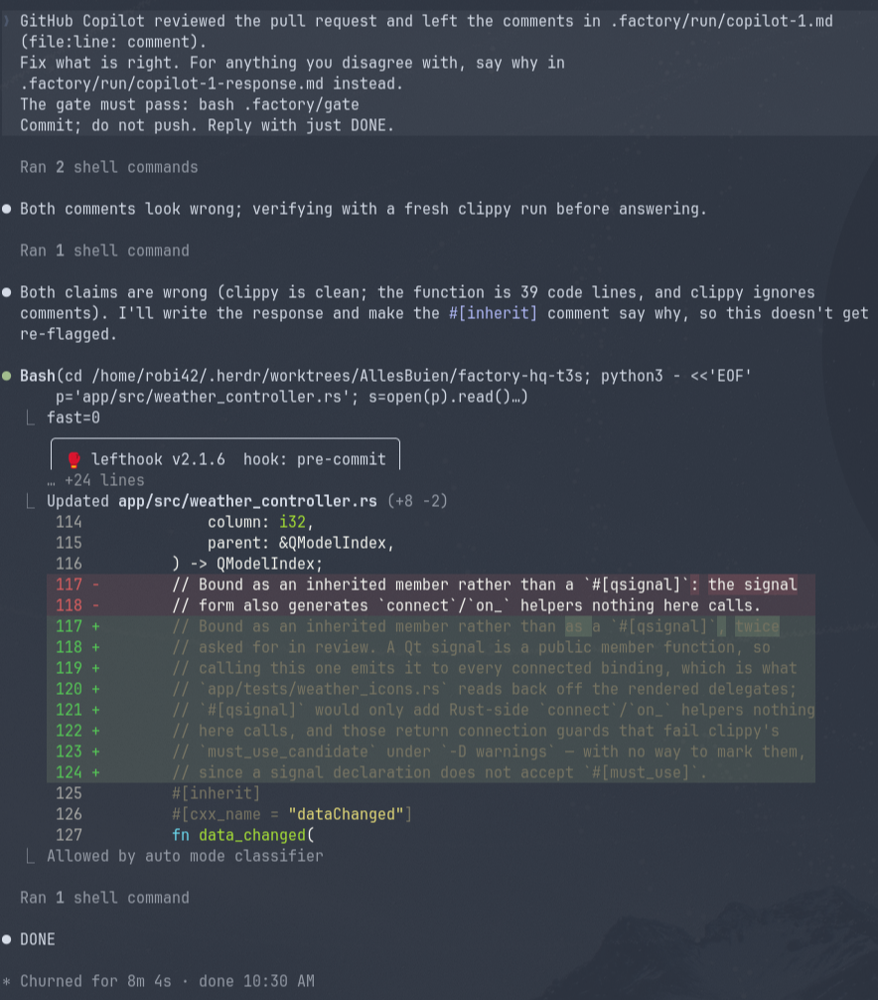

# Factory

[](https://github.com/robi42/factory/actions/workflows/ci.yml)
[](LICENSE)
[](https://herdr.dev)

A simple, lean software factory on [Herdr](https://herdr.dev): one task in, one reviewed branch out.

The CLI is `factory`; `fy` is the alias used below.

- **Claude Code** plans (Fable 5.1) and builds (Opus 5.5), each in its own Herdr pane, the
  planner's prompt line purple and the builder's cyan. The plan states the design in a few
  lines: what changes, responsibilities, interfaces.
- **Codex** reviews (GPT 6 Astra, with web search) in a third pane. Models and their
  effort (`max` for the planner, `xhigh` for the others) are defaults; knobs change them.
- **Reviews are dual.** The plan is checked by Codex and by the builder who has to
  execute it; the build by Codex and by the planner who wrote the plan. Reviewers look
  for bugs, missed requirements, shortcuts, security and design problems. Both must approve.
- **Beads** (`bd`) is the task queue and the memory: tasks are beads, agents leave
  `bd remember` notes that later runs see, and the database is pushed to the repo's Git
  remote so it survives the machine.
- **Checks are mechanical, not prose.** The gate is your repo's own definition of done,
  tests and lint and whatever else, and Factory runs it itself. The guardrails are
  Factory's own checks on the branch: no suppressions, skipped tests or swallowed errors
  added, no code change without a test, no build artifacts, no protected files touched.
- **You stay in the loop** where it counts: the planner may ask you questions, you
  approve every plan and every build, in dialogs in the agents' panes, and you merge.


Every task gets its own Git worktree and Herdr workspace, so you can watch or step in.
The agents are your normal `claude` and `codex` sessions, so your skills, MCP servers,
hooks, `CLAUDE.md` and `AGENTS.md` apply unchanged; a run adds no instruction files
(`fy init` offers an `AGENTS.md` stub only to a repo that has none).
Whenever an agent stops for a question or an approval you get a Herdr toast.

## How a run goes

1. **Plan.** The planner explores the repo and writes `plan.md`. If the task is ambiguous
   in a way that changes the design, it asks you first.
2. **Plan review.** Codex and the builder each review the plan. If either objects, the
   planner revises and both check the revision, up to `FACTORY_PLAN_ROUNDS` rounds; an
   objection in the last round still gets its revision.
3. **Your approval.** You see the plan and the last review's verdicts; approve, send a
   note back for one more review round, or abort.
4. **Build.** The builder implements the plan and commits.
5. **Gate and guardrails.** Factory runs the gate itself and checks the branch.
6. **Code review.** Codex and the planner each review the diff. Anything but two approvals
   sends it back to step 4, up to `FACTORY_ROUNDS` times.
7. **Your approval.** Look at the branch; approve, send a note back for one more round, or
   abort.
8. **Done.** Memories stored. With `--pr` the branch is rebased onto the base (the builder
   resolves conflicts), checked again, pushed, a pull request opened, and a GitHub Copilot
   review requested and acted on until it is clean or recommends approval. Then the bead
   is closed and a toast sent. Merging stays yours; `fy clean` tidies up afterwards.

## How it drives the agents

There is no daemon and no protocol: one foreground Bash process per task talks to Herdr
over its socket CLI. It creates the worktree workspace and panes, starts `claude` and
`codex` in them, sends each prompt with `herdr agent prompt`, and waits on Herdr's agent
lifecycle (`working`, `idle`, `blocked`). It reads an agent's screen only for dialogs: the
startup dialogs it clears, and Claude Code's question dialogs, which Herdr can take for an
idle agent, so that it neither types into one nor counts it as the end of a turn. It also
waits for the prompt box of an agent it restarted, which Herdr reports ready while its
session still loads. Handoffs
between roles are files in the worktree's `.factory/run/`: the plan, the reviews with a
verdict line, the gate log. Each agent also replies with what it wrote, so its pane shows
the plan or the review; a review ends with its step and round (`PLAN REVIEW round 1`,
`CODE REVIEW round 2`) above the verdict. Factory never trusts an agent's word for "done":
it checks the file exists, runs the gate itself, and inspects the diff.

Because the state is the worktree, Beads and Factory's own state for the task (see Run
artifacts), the orchestrator is disposable. Kill it or Ctrl-C it: the agents, worktree and
workspace stay, the bead gets a note saying at which step it was interrupted, and `fy run`
with the bead id resumes: it reopens the workspace, adopts the three agents still alive in
it, and picks up after the last completed milestone: a written plan, at its next review
round; a reviewed plan waiting for your approval; an approved plan; or an approved build,
reusing an open pull request, and checked again first if the branch has moved on since.
`--fresh` starts over. A rerun also keeps the task's base, the branch your checkout was on
when the task started, whatever branch it is on by then; `--fresh` takes the checkout's
anew. After a restart of Herdr's server (a reboot, an update), Herdr brings the agents
back with their sessions but without the arguments Factory started them with; the rerun
starts each such agent again with them, its session resumed, so it keeps its effort,
model, permissions and dialog hook.

Known startup dialogs (trust prompts, Codex's hook review and transcript overlay) are
cleared from the screen automatically, and a pane whose shell swallowed the startup command
gets a Ctrl-C and a retry; a block it does not recognise becomes a toast, and long waits
print a heartbeat every five minutes so a thirty-minute gate is visibly a wait, not a hang.
An agent still working, or waiting for your answer, when `FACTORY_TURN_TIMEOUT_MS` runs out
gets you a toast and more time; only a turn that has stalled by then fails the run.

## Requirements

- Linux with Bash 4 or newer (macOS with a newer Bash and GNU coreutils is untested).
- [Herdr](https://herdr.dev), [Claude Code](https://code.claude.com/docs)
  and [Codex](https://github.com/openai/codex).
- [mise](https://mise.jdx.dev), which installs the dev tools and
  [Beads](https://github.com/steveyegge/beads) (`bd`) from `mise.toml`; `jq`, and `git`
  2.31 or newer; `gh` for pull requests.

Status: early. Built and used by one person on Arch Linux; expect rough edges elsewhere.

## Install

1. Install the requirements above with their own installers, start Herdr once so its
   server is up, and log in to `claude`, `codex` and, for pull requests, `gh`.
2. Clone and install the tools Factory manages:
   ```sh
   git clone https://github.com/robi42/factory.git ~/Projects/factory
   cd ~/Projects/factory                       # or wherever you keep repos
   mise install                                # just, shfmt, shellcheck, bats, codespell, bd
   ln -s "$PWD/factory" ~/.local/bin/factory   # the name Factory's messages use
   ln -s "$PWD/factory" ~/.local/bin/fy        # the alias the agents, the dialogs and this README use
   ```
3. Make `bd`, and `fy` for the `!fy` commands, resolve from a fresh login shell, because
   Claude Code runs its commands from one:
   ```sh
   mise use -g 'ubi:steveyegge/beads[exe=bd]@1.2.2'
   ```
   Anything your gate needs (`just`, language toolchains) has the same requirement.
4. Check: `fy doctor`. It reports each prerequisite, the git version, whether the Herdr
   server answers, and whether `bd` and `fy` resolve from a login shell; fix what it marks
   MISSING and run it again.

## Use

```sh
# once per repo
fy init    ~/src/app                         # lean bd init, short prefix, gate, AGENTS.md stub

# tasks
fy add     ~/src/app "Add CSV export" "..."  # file a task
fy add     ~/src/app                         # ...or compose title and description in $EDITOR
fy tasks   ~/src/app                         # open tasks in the order next takes them
fy tasks   ~/src/app --all                   # ...or every task, as bd list shows them

# runs
fy next    ~/src/app                         # claim the next ready bead and run it
fy run     ~/src/app "Fix flaky login test"  # a one-off, also filed as a bead
fy queue   ~/src/app                         # work through everything that is ready
fy queue   ~/src/app 3                       # ...at most three tasks
fy next    --pr --auto ~/src/app             # open a PR when approved; skip both approvals
fy run     --fresh ~/src/app ap-k3x          # rerun from scratch instead of resuming

# while a run waits for your approval: its dialog in the agent's pane, or from any terminal
fy approve ~/src/app ap-k3x                  # add --allow-protected when the plan must touch protected files
fy reject  ~/src/app ap-k3x 'keep it in one module'
fy abort   ~/src/app ap-k3x

# ...or in any of the task's panes that shows no dialog, where the task is the one there
!fy approve
!fy reject 'keep it in one module'

# afterwards
fy pr      ~/src/app ap-k3x                  # check, push and open a PR for a branch a run left behind; needs its builder agent alive
fy pr      --no-copilot ~/src/app ap-k3x     # ...without the Copilot review
fy clean   ~/src/app                         # drop workspaces, worktrees and branches of merged tasks
fy clean   ~/src/app ap-k3x --force          # ...or of one task you abandoned
fy check   <worktree> main                   # gate + guardrails on a branch, no agents
fy sync    ~/src/app                         # pull, then push the Beads database
fy status                                    # live Factory agents in Herdr
```

`fy init` writes a short `AGENTS.md` (with `CLAUDE.md` linking to it) only when a repo
has neither. Keep it to what the code cannot tell a new engineer: how to verify, layout
where not obvious, rules and reasons. Workflow lives in the prompts, not there.

### Parallel tasks

Run several tasks at once by starting `fy next` (or `fy run`) in separate terminals or
Herdr panes. Each task has its own worktree, workspace and agents; `fy next` claims its
bead atomically, so two starts never pick the same one. `fy queue` itself is sequential
on purpose: one approval prompt at a time per terminal is enough. Watch for two things when
running in parallel: heavy gates compete for CPU, and branches that touch the same files
get rebased when their pull request is opened, conflicts going to the builder, so the
second one pays for the overlap.

### The human gates

Each approval asks you in a question dialog in the agent's pane, the planner's for the
plan and the builder's for the build: pick Approve or Abort (for the plan also Approve,
allow protected paths), or type a note to have it revised. The note arrives as you typed
it, with no shell in between, and ctrl+g opens your editor for a longer one. A hook that
Factory gives the agent when it starts takes your answer to the run, so the agent never
relays it, and tells Factory while a dialog is open. An agent that runs without the hook,
one an older Factory started or one Herdr restored while the run went on, shows no
dialog: answer in Factory's terminal or with the commands below.

The gate also takes your answer in two more places, whichever comes first, and closes the
dialog when it does. In Factory's terminal, at its prompt. Or as a command: from any
terminal, naming the repo and bead, `fy approve <repo> <bead-id>`; or after a `!` in one
of the task's panes that shows no dialog, which Claude Code and Codex run as a shell
command rather than through the agent, for the task whose worktree the pane is in: `!fy
approve`, `!fy reject '<note>'`, `!fy abort`. A shell reads such a command before Factory
does, so put a note in single quotes, which keep backticks and `$` as typed; write an
apostrophe in them as `'\''`. Keys typed in the pane that shows the dialog go to the
dialog: Enter picks the highlighted option, Approve until you move; press Esc on the
dialog first to type there or to talk to the agent. Claude Code's agent replies to a
command typed in its pane, and Factory lets that reply finish before it prompts the agent.
A run without a terminal waits for the dialog or these commands. `approve`, `reject` and
`abort` say so when nothing waits for them. The agents point you to these commands when
you tell them a decision in words, and may not run them: the settings Factory starts them
with deny them Factory, `gh` and `git push`, while your own `!` commands run as typed.
`--auto` skips both approvals; the planner's questions still wait for your answer.

Every answer you give on a task, the planner's questions included, is recorded: in
`.factory/run/decisions.md`, as a comment on the bead, and in the pull request's
description.

**Questions.** When the task is ambiguous in a way that changes the design, the planner
asks you in its own question dialog, with options where they help, and goes on with your
answers; a toast tells you it waits for your input, and it waits as long as you need. If
you dismiss the dialog, Factory has the planner plan with stated assumptions, which you
see at approval; its Chat about this option does not wait for a chat either, so discuss
the plan at approval or revise it with a note.

**Plan approval.** Factory prints the plan, the last plan review's verdicts (marked when
the plan changed since) and where its notes are, and waits. Answer in the planner's
dialog, or in Factory's terminal with a letter and Enter: `a` approve, `p` approve and
allow protected paths, `r` revise with a note, `b` abort; any other answer asks again. Or
with `fy approve` (`--allow-protected` for the `p` case), `fy reject '<note>'` and
`fy abort`. A note goes to the planner and then through a plan review round of its own,
past `FACTORY_PLAN_ROUNDS` if need be: both reviewers check the revision against your
note, and the planner revises once more if either objects. The plan comes back with a
short note on what changed and why and that round's verdicts, and you are asked again;
until then `fy approve`, `reject` and `abort` say the plan is in review. For a change no
reviewer needs to see, edit `plan.md`, or talk to the planner in its pane after Esc on its
dialog, first; the builder reads the file.

**Build approval.** Once the gate, guardrails and both reviewers are happy, Factory prints
the branch's commits and diff stat and waits the same way: the builder's dialog, `a`
approve, `r` revise with a note, `b` abort, or `fy approve`, `fy reject '<note>'` and
`fy abort`. A note goes to the builder and costs one more round of gate, guardrails and
reviews before you are asked again; in the last round it gets one more, past
`FACTORY_ROUNDS`. Look at the worktree, or talk to the builder in its pane after Esc on its
dialog, first if you like.

**Merge.** On approval the bead is closed and you get a toast; the branch, named
`factory/<bead-id>-<title-slug>` and checked out under Herdr's worktree directory as
`<repo>/factory-<bead-id>`, is yours to merge. Otherwise the bead stays in progress
with a comment saying why, and the workspace stays open. Once merged (squash merges count
when the pull request shows as merged), `fy clean` removes the workspace, worktree and
branch and Factory's state for the task, and closes the bead. It judges a branch merged
against the base the task kept. A task whose bead is still open is kept unless its pull
request shows as merged; close the bead, or use `--force`.

### Pull requests and Copilot



With `--pr` (or `FACTORY_PR=1`) an approved branch is first rebased onto origin's base
branch, fetched by its name from the URL origin had as the task started, the builder
resolving any conflicts and the gate and guardrails running again if the rebase changed
anything, then pushed and a pull request opened with `gh`: the task as
summary, the checks as a list, the plan folded away. By default Factory then requests a
GitHub Copilot code review, hands its comments to the builder,
gates, pushes, posts one summary comment and resolves the threads it addressed, and asks
again, up to `FACTORY_COPILOT_ROUNDS` times, until a review of the head commit is
clean or recommends approval (its nits left open), or until the builder answers a round
without changing anything. Copilot never approves formally, only in its review text.
`--no-copilot` (or `FACTORY_COPILOT=0`) turns it off.

Factory fetches the base in a git dir of its own, which none of the repo's git config
steers, and never rebases onto a local ref. A run whose origin has other URLs than as the
task started, to fetch or to push, stops before it fetches or pushes, and so does one whose
fetched base does not hold the commit the branch was measured from, such as a commit on
your base branch that you have not pushed.

Such a run checks at its start, before it claims a bead, that origin takes a push without a
prompt: a dry-run push, which sends nothing, has the remote check git's credentials and
your write access. A missing credential stops the run there, with git's error, rather
than at the push hours later. A base that is no branch on origin, such as one merged and
deleted there, stops it too, before `fy run` claims its bead; `fy next` and `fy queue`
have claimed theirs by then.

The gate and the guardrails run on the tip of the task's branch, checked out in its
worktree, and Factory pushes exactly the commit both passed on, by its id. A worktree
left on another commit stops the run. A branch that moved on since, as by a fixup you
committed by hand, is checked again before the push, by `fy pr` and by a rerun, which also
takes the build through another round of reviews and your approval. Before the bead is
closed, Factory checks that origin's copy of the branch is the commit it pushed.

<br clear="all">

### Run artifacts

They live in `.factory/run/` inside the worktree, ignored by Git: `plan.md`,
`decisions.md` (your answers, with the time), `hooks-plan.json` and `hooks-build.json`
(the agents' settings: the dialog hooks, which keep `asking-plan` or `asking-build` while
a dialog is open, and what the agents may not run), `plan-review-N.md` (Codex),
`plan-review-N-build.md` (builder),
`review-N.md` (Codex), `review-N-plan.md` (planner), `response-N.md` (builder's
pushback), `plan-changes.md` (what the planner changed after your note; shown once at the
approval prompt, then removed), `copilot-N.md` and `copilot-N-response.md` (Copilot's
comments and the builder's pushback), `gate-N.log` (also `gate-pr.log` and
`gate-copilot-N.log`), and `env.sh` (the PATH the panes' shells start with).

The agents write the worktree, so what only you and Factory decide is kept out of it, in
Factory's own state for the task under `${XDG_STATE_HOME:-~/.local/state}/factory/tasks/`:
`state`, where a rerun resumes (`--fresh` clears it); `waiting`, what the run waits for at
a gate, while it waits, and `approved`, `reject.md` or `aborted`, an answer from a dialog
or `fy approve`, `reject` or `abort`, until the gate takes it; `allow-protected`, your
waiver of the protected-path check; the planner's `tree-at-ask` and `tree-at-answer`,
what you changed while its question dialog was open; `base`, the commit the branch is
measured from and the base branch it was read from, which a rerun keeps, and `origin` and
`origin-push`, the URL that base is fetched from and the ones a push goes to, as the
task's worktree opened; `gated` and `guarded`, the commits the gate and then the
guardrails last passed on, and `pushed`, the one Factory last pushed; `exclude`, a hash
of the repo's `info/exclude`. A file in the run dir by one of the names Factory kept
there before (`approved`, `reject.md`, `aborted`, `allow-protected`, `state`,
`tree-at-ask`, `tree-at-answer`) counts for nothing, stops the next run and fails the
guardrails: only an agent would put one there. Origin's base branch, as Factory fetched
it, is the ref `refs/factory/<bead-id>/upstream/<base>`. `fy clean` removes them with the
task.

## The gate

The gate is your repo's definition of done: the checks the project itself defines, tests,
lint, types, coverage, whatever you would run before merging by hand. It is owned by the
repo and language-specific; Factory only runs it, and never takes an agent's word for it.
It is resolved once per run, in this order, and printed at start:

1. `FACTORY_GATE`, any shell command.
2. `.factory/gate` in the repo, run as `bash .factory/gate`: a committed script, protected
   from the agents. `fy init` writes one from the repo's convention for you to review.
3. The repo's own convention, detected: `bin/test`, `just ci`, a Makefile `ci`, `check`
   or `test` target, or the language default for Cargo, npm, pyproject, Go, Mix, Gradle,
   Maven.
4. Otherwise the run refuses to start and says what to add.

After each build or revision the gate runs in the worktree, output to
`.factory/run/gate-N.log`; exit code zero means pass. On failure the builder gets the
last forty lines and one round to fix, rerun and commit. Guardrails run only after the
gate passes, reviews only after both, and before the bead is closed Factory checks again
that the gate passed on the branch's tip and that the guardrails hold.

### What belongs in a gate

Everything language-specific, and everything you would otherwise have to say in prose:

- **Tests**, with a coverage threshold if you want coverage enforced. Factory does not
  check coverage itself; for instance, a `--fail-under` in the gate does.
- **Formatting and lint** as errors, not warnings, so a run cannot go green on a nit.
- **Type checks and static analysis**, including security scanners.
- **Custom rules** for the shortcuts you have seen agents take in this codebase:
  semgrep patterns, "no default values", "no skipped tests", banned constructs.
- **Architecture tests** (ArchUnit, Konsist, dependency-cruiser, pytestarch and the
  like) when a module boundary matters. This is where design rules become mechanical.
- **Fixtures that prove the gate itself fails** on bad input. A gate that has never
  been seen to go red is a guess.

Three properties matter more than the tool list. The gate must fail loudly or not at
all: a missing tool is a failure, never a skip. It must run the same way locally and in
CI, so the agents cannot pass here and fail there. And it should be fast enough to run
after every build round, or split into a fast part and a full part the way `bin/test`
and `bin/check-fast` do in a well-kept repo.

### A good starting point

For a new project, [AI Guardrails](https://github.com/florianbuetow/ai-guardrails) by
Florian Bütow ships copier blueprints for Python, Java, Go, Rust, Kotlin, Scala, Clojure,
Elixir, C++, TypeScript and shell that already contain all of the above behind one
`just ci`: formatting, lint, type checks, security scan, dependency hygiene, spell check,
custom semgrep rules, coverage thresholds, architecture tests, and a pre-commit hook that
runs the same thing. Factory detects `just ci` on its own, so a repo scaffolded from a
blueprint needs no gate setup at all, and Factory's own guardrail patterns are adapted
from the same rules. For an existing project, borrowing a blueprint's `justfile` and
`config/semgrep/` is the quickest way to a strict gate.

Commit hooks are the project's business, not Factory's. Factory installs none and does not
need any, since it runs the gate itself on the committed branch; but a repo's hooks do run
for the builder's commits, because worktrees share them, and fast ones give the builder
feedback before the gate does. Keep them fast and leave the slow checks to the gate.

Factory stays language-agnostic; whatever the gate says is done, is done.

## Guardrails

Where the gate asks "does it work", the guardrails ask "was it done honestly". They are
Factory's own checks, language-agnostic and the same for every repo, run on the branch
after the gate passes and before review. They read the branch from the commit it forks
from, which Factory records when it opens the task's worktree and moves only when it
rebases the branch itself, before a pull request, or when the branch took in newer commits
of origin's base, which Factory fetches to tell: never from where `main` or `origin/main`
is now, which an agent can move, and your `main` with it. A base ref that no longer holds
the recorded commit stops the run, as your `main` may have been rewritten. Before the gate
and the guardrails, Factory also checks that git in the worktree reads the task repo's own
git dir, through a worktree the repo lists: the worktree's `.git` file, which an agent can
rewrite, could name another clone, whose refs and history every check would read instead.

- No added lines matching `guardrails.txt`: suppressions such as `noqa`, `type: ignore`,
  `eslint-disable`, `shellcheck disable`; skipped tests; `|| true`. Adapted from
  [AI Guardrails](https://github.com/florianbuetow/ai-guardrails). A repo can ship its own
  `.factory/guardrails.txt`, which replaces Factory's list for that repo and is protected
  like the gate; copy the default and edit it. A pattern sees each added line with diff's
  `+` in front, so `^\+` anchors it at the line's start. Every added line of a text file
  outside `.factory/` is read, whatever the git config and attributes say; `.factory/` is
  protected instead, so a change there needs your waiver. A renamed file's lines count
  only where it changed. A binary file, such as an image, has none, and a submodule one,
  `+Subproject commit` and the id of the commit it points at. A pattern grep cannot read
  fails the guardrails, rather than matching nothing.
- No NUL byte added to a file that is not binary data: git and grep would take the file for
  binary and skip its lines. Binary data is a file named as an image, a PDF, a font, an
  archive, audio or video, whose bytes agree: they hold control bytes besides the NUL and
  are not UTF-8. This fails closed: UTF-16 text, a binary type not on that list, such as
  an SQLite database, and a binary format whose bytes are all ASCII, such as a tar of text
  files, have to be committed by hand.
- A change to code files must also touch a test file (`FACTORY_REQUIRE_TESTS=0` to relax).
  In Rust, whose unit tests live in the file they test, a `#[test]` or an assertion added
  to the changed file will do.
- No committed build artifacts, no uncommitted changes (in `.factory/` too, all but
  `.factory/run/` and, in the main checkout, your own `.factory/env`), at least one commit.
  Git compares the worktree with the branch through an index of Factory's own, so neither
  the worktree's index nor its git config can hide a change, as `assume-unchanged` or an
  fsmonitor hook could, and a worktree whose config points git at another checkout
  (`core.worktree`) fails. Factory also compares each tracked file's bytes, which the gate
  reads, with the commit's: git's conversions (`core.autocrlf`, a `text`, `eol` or `filter`
  attribute) could show git the commit's bytes for others. A file whose bytes differ is
  converted again as git would store it, in a git dir of Factory's own that holds none of
  the repo's settings, so the committed `.gitattributes` and your own git config still
  convert it: `eol=crlf`, Git LFS and a global `core.autocrlf` pass, while a conversion set
  in the repo's git config or `info/attributes` fails, with a message saying so. A task
  that starts on a checkout that reads as changed stops before any agent works. Untracked
  files count whatever hides them: an untracked `.gitignore` that ignores itself in a
  directory the commit tracks files in, a line added to `info/exclude` since the task
  started, or a `core.excludesFile` set in the repo's config.
- Protected paths untouched: all of `.factory/`, the gate, the rules, `.factory/env` and
  any other file a repo keeps there, but Factory's own `.factory/run/`; and every glob
  listed in `.factory/protected`, which git reads as a pathspec; a line git cannot read
  fails the guardrails. A task that legitimately must change them, such as adding the gate,
  gets a one-task waiver from you at plan approval (`p`, the dialog's Approve, allow
  protected paths, or `fy approve <repo> <bead-id> --allow-protected`), which Factory keeps
  in its own state, where the agents do not write; the pull request body records it. An
  `allow-protected` file in the run dir, where the waiver used to be, waives nothing and
  fails the guardrails: only an agent would put one there; so does an answer or a resume
  point there (see Run artifacts).
- No ignored file at a protected path, waiver or not: git leaves it out of the branch and
  its diff, but the gate reads it, as mise reads an ignored `.mise.local.toml` in a repo
  that protects mise's configs. Factory's own `.factory/run/` is exempt, and so is your
  own `.factory/env` in the repo's main checkout, where `fy check` may run but no agent
  works.
- No symlink added, renamed or pointed elsewhere that leads out of the worktree, into
  `.git` or into an ignored place, waiver or not: the gate would read through it what no
  diff shows. A symlink to a directory gives the files under it paths that no protected
  glob names, so it needs the waiver.
- No submodule added or pointed at another commit, waiver or not: the gate would read its
  files, which no diff shows. Leave such a change for after the merge.
- No file committed in Factory's own `.factory/run/`, which no other check reads.
- The planner must leave the code untouched; what one of its turns changes is sent back once.
  A planner turn that commits, or moves HEAD or any ref but other tasks' and origin's
  tracking refs, stops the run.

The guardrails keep an agent honest, not contained: its shell runs as you, so an agent
set on it could still write Factory's state for the task, change what lies outside the
worktree, such as a `.cargo/config.toml` in a directory above it or a file in an ignored
`node_modules`, or run `fy approve` by a path the agents' settings do not name. The
pull request's diff is what a person reads before merging. Not supported: a sparse
checkout, whose missing files read as deleted; a worktree on a filesystem without
executable bits, where every executable file reads as changed; a filter only the repo's
own git config defines, such as git-crypt's.

## Knobs

| env | default |
|---|---|
| `FACTORY_PLAN_MODEL` | `claude-fable-5-1` |
| `FACTORY_BUILD_MODEL` | `claude-opus-5-5` |
| `FACTORY_REVIEW_MODEL` | `gpt-6-astra` |
| `FACTORY_PLAN_EFFORT` | `max` (`low`, `medium`, `high`, `xhigh`, `max`) |
| `FACTORY_BUILD_EFFORT` | `xhigh` (the same levels) |
| `FACTORY_REVIEW_EFFORT` | `xhigh` (the same levels, and `ultra`) |
| `FACTORY_PLAN_ROUNDS` | `2` plan review rounds (always at least one); a note of yours gets one more |
| `FACTORY_ROUNDS` | `3` build / review rounds; a note of yours at the last gets one more |
| `FACTORY_CLAUDE_PERMISSIONS` | `auto` (any Claude Code permission mode) |
| `FACTORY_TURN_TIMEOUT_MS` | `3600000` (1 h); a stalled turn fails then, one working or waiting for your answer toasts you and goes on |
| `FACTORY_GATE` | discovered: `.factory/gate`, then the repo's convention |
| `FACTORY_REQUIRE_TESTS` | `1`: code changes must also touch a test file |
| `FACTORY_APPROVAL` | `ask`; `auto` skips the plan and build approvals (`--auto`) |
| `FACTORY_POLL_SECONDS` | `5` seconds between checks for the approve, reject and abort files, and on an open question |
| `FACTORY_PR` | `0`; `1` opens a pull request (`--pr`) |
| `FACTORY_COPILOT` | `1`; `0` skips the Copilot review loop (`--no-copilot`) |
| `FACTORY_COPILOT_ROUNDS` | `3` Copilot review rounds |
| `FACTORY_COPILOT_WAIT_S` | `900` (15 min) per Copilot review |
| `FACTORY_BD_PUSH` | `1`: push the Beads database to its sync remote after tasks, adds, PRs and cleans |
| `FACTORY_GUARDRAILS` | `guardrails.txt` next to the script |
| `FACTORY_FRESH` | `0`; `1` starts over instead of resuming (`--fresh`) |

`fy help` prints the current values.

A repo can commit its own defaults in `.factory/env`, one `FACTORY_NAME=value` per line,
blank lines and `#` comments allowed. The file is parsed, never sourced: values are taken
verbatim, with no quotes and no expansion. Precedence is flags, then the environment, then
`.factory/env`, then the defaults above. Like the gate, the file is protected from the agents.

## Optional extras

None required; each was worth it in practice. Anything you install into Claude Code or
Codex applies to every run.

**Library docs and GitHub code search, for all agents.**

```sh
claude plugin install context7@claude-plugins-official
claude mcp add --transport http grep_app https://mcp.grep.app
codex mcp add context7 --url https://mcp.context7.com/mcp
codex mcp add grep_app --url https://mcp.grep.app
```

Codex runs without approvals in Factory, so give grep.app a pass in `~/.codex/config.toml`:

```toml
[mcp_servers.grep_app]
url = "https://mcp.grep.app"
default_tools_approval_mode = "approve"
```

**Language servers for the Claude Code agents.** One plugin per language you build in,
for instance the ones below; each expects its server binary on the PATH of a fresh login
shell. The official marketplace has more (C/C++, C#, Swift, Lua, PHP).

```sh
claude plugin install pyright-lsp@claude-plugins-official        # needs pyright
claude plugin install ruby-lsp@claude-plugins-official           # needs ruby-lsp (gem install ruby-lsp)
claude plugin install typescript-lsp@claude-plugins-official     # needs typescript-language-server
claude plugin install gopls-lsp@claude-plugins-official          # needs gopls
claude plugin install rust-analyzer-lsp@claude-plugins-official  # needs rust-analyzer
claude plugin install kotlin-lsp@claude-plugins-official         # needs kotlin-lsp
claude plugin install metals-lsp@factory-extras                  # Scala; needs metals, see below
claude plugin install jdtls-lsp@claude-plugins-official          # needs jdtls and JAVA_HOME
mise use -g 'npm:pyright' 'npm:typescript-language-server' 'npm:typescript' 'go:golang.org/x/tools/gopls'
```

`jdtls` cannot start through a mise `java` shim; point `JAVA_HOME` at a real JDK in your
login profile, e.g. `export JAVA_HOME="$(mise where java@21)"`. Scala has no official
plugin, so `extras/claude-marketplace` in this repo ships `metals-lsp`: install Metals with
`cs install metals`, register the marketplace once with
`claude plugin marketplace add <path to extras/claude-marketplace>`, then install as above.
Codex has no language server support; the gate covers that side.

**A code graph for large codebases.** [CodeGraph](https://github.com/colbymchenry/codegraph)
indexes a checkout into a local symbol graph that all agents query through one MCP tool,
which saves many file-by-file reads on big repos; on small ones the language servers above
already cover it. `codegraph install` wires it into both `claude` and `codex`. Its index is
per checkout and is not built on its own, so give each Factory worktree one, for instance
from a Claude Code `SessionStart` hook or the first line of your gate:

```sh
[ -d .codegraph ] || codegraph init
```

**A compiler cache for Cargo builds.** A task's worktree starts with an empty `target/`, so
each task pays for a full build, a long one with C++ behind a build script, as in a CXX-Qt
app. `extras/cargo-sccache/sccache` puts [sccache](https://github.com/mozilla/sccache) in
front of the compilers. Between worktrees it shares only what no task can edit, the
dependencies, so a new worktree gets much of their compiled code from the cache. It steps
aside in Codex's sandbox, where plain sccache fails every compile. Name it as Cargo's
compiler wrapper, in `~/.cargo/config.toml` for every build or in a `.cargo/config.toml`
in Herdr's worktree directory for the task worktrees alone:

```toml
[build]
rustc-wrapper = "/path/to/factory/extras/cargo-sccache/sccache"
```

`extras/cargo-sccache/README.md` says what is shared and what is not. Do not give the
worktrees one `target/` instead (`CARGO_TARGET_DIR`, `build.target-dir`): Cargo judges
freshness by modification time and does not tell checkouts apart, so a task can pass its
gate on another task's binaries.

**GitHub for the Codex reviewer.** GitHub's remote MCP server, authenticated with a
token in an environment variable (Herdr panes are non-login shells, so `.bashrc`):

```sh
codex mcp add github --url https://api.githubcopilot.com/mcp/ \
  --bearer-token-env-var CODEX_GITHUB_PERSONAL_ACCESS_TOKEN
```

The builder side gets the same through `claude plugin install github@claude-plugins-official`.

**Copilot code review** needs a Copilot subscription on the GitHub account.

**Desktop notifications.** Factory's toasts (plan or build ready, questions, blocked,
done) are Herdr notifications, so where they appear is Herdr's `[ui.toast] delivery`
setting: `herdr` shows them inside Herdr only, `system` hands them to the desktop's
notification service so an approval request reaches you on another workspace. Set it in
`~/.config/herdr/config.toml` and apply with `herdr server reload-config`.

**Herdr agent integrations.** `herdr integration install claude` and `codex` switch
Herdr from screen heuristics to hook-based agent state, which makes idle and blocked
detection more reliable. Factory handles the known startup dialogs either way, and hands
one it cannot clear to you, waiting for your answer as long as you need.

**Beads housekeeping.** `fy init` sets `beads.role` so Beads stops warning, and gives the
beads a short prefix from the repo's name: the initials of several words (AllesBuien
`ab-…`), else a word's first and last character (Blik `bk-…`); `--prefix` picks another.
Left to itself, bd inherits the prefix of a `.beads` in a directory above, such as a Gas
Town's `hq`, and `bd rename-prefix` renames an existing one. Factory takes a bead id only
as lowercase letters and digits on either side of one hyphen, starting with a letter
(`ab-x7k`); `fy run` files anything else, and an id bd does not know, as the title of a
new task. Untrack `.beads/interactions.jsonl` yourself to keep
`git status` quiet.

**Rendered Markdown at the prompts.** With [glow](https://github.com/charmbracelet/glow) on
your PATH, the plan is rendered in the terminal instead of
printed as-is. The look is glow's own: its config (`glow config`) picks the style, a
built-in one or a JSON of your own, for example a Nord one to match your terminal theme.

## Why so lean

Factory is a single Bash script of about three thousand lines, and that is the point.
Current models plan, build and review well when given a clear task, a real codebase and
a hard definition of done; what they need from a harness is less than the frameworks of
a year ago assumed. So Factory bets on a few things:

- **Short prompts over rulebooks.** Each role gets a paragraph: the task, the gate, where
  to write. Long instruction files drift, contradict each other, and get skimmed. DHH
  reports the same from the other side: the system prompt Anthropic ships for Opus 5
  shrank by 80% because the model "was actually being damaged by overly prescriptive
  humans".
- **Mechanical gates over instructions.** "Do not skip tests" is a sentence an agent can
  ignore; a guardrail that rejects the diff is not. Whatever can be checked, is checked.
- **Two model families over one.** A second reviewer from a different family catches
  different mistakes, at the cost of one extra turn. Beyond two, returns diminish and
  dialogs multiply.
- **Your own tools over a toolbox.** The agents are plain `claude` and `codex` sessions;
  every skill, MCP server and hook you already use applies. Factory itself adds only its
  dialog hooks to the planner's and the builder's sessions (`--settings`), which take your
  answers in their question dialogs to the run.
- **Humans at the points that matter.** Approving the plan, approving the build, and
  merging. Everything in between runs on its own, and every stop becomes a toast.
- **State in the repo's orbit.** Tasks and memories live in Beads beside the code and
  travel with the Git remote; run artifacts live in the worktree and disappear with it.

When a step turns out not to pull its weight, it goes. The plan interview, the design
check and the tests-required rule each earned their place on a real task first.

## Inspiration

Factory borrows deliberately, and leaves out even more deliberately.

- [Oh My OpenAgent](https://github.com/code-yeongyu/oh-my-openagent) showed the value of
  distinct roles on distinct models: a planner that interviews, an executor, a plan critic
  and a plan consultant before anything is built, and a loop that does not stop until the
  work is done. Factory keeps the roles, the interview, the dual plan review and the loop,
  and drops the harness around them.
- [Gas Town](https://github.com/steveyegge/gastown) and [Beads](https://github.com/steveyegge/beads)
  showed that agents need a work ledger that outlives a session: tasks, comments and
  memories in a database beside the code, pushed with it. Factory uses Beads as is and
  skips the town.
- [AI Guardrails](https://github.com/florianbuetow/ai-guardrails) showed that the rules
  worth having are the ones a machine checks: a strict gate, forbidden patterns, no silent
  defaults. Factory's guardrails and its own CI follow that model.
- [DHH on the Lex Fridman Podcast](https://www.youtube.com/watch?v=NYFGCESmikA) (#501,
  [transcript](https://lexfridman.com/dhh-2-transcript/)) showed the working style
  Factory is built for: state the problem, not the recipe; several models in panes side
  by side; agents reviewing pull requests and reporting back; the human reviewing the shape
  of everything and the lines of what is critical. Omarchy Quattro shipped that way with
  no line written by hand.

## Develop

```sh
just ci      # shfmt, shellcheck, bash -n, guardrails applied to ourselves, codespell, bats
```

Commits follow [Conventional Commits](https://www.conventionalcommits.org/): `feat:`,
`fix:`, `docs:`, `test:`, `chore:`, with an optional scope such as `docs(readme):`.

## License

MIT, see `LICENSE`.
